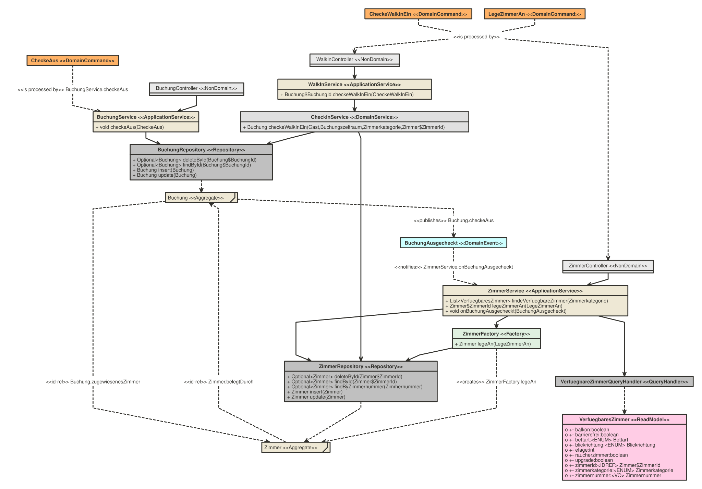
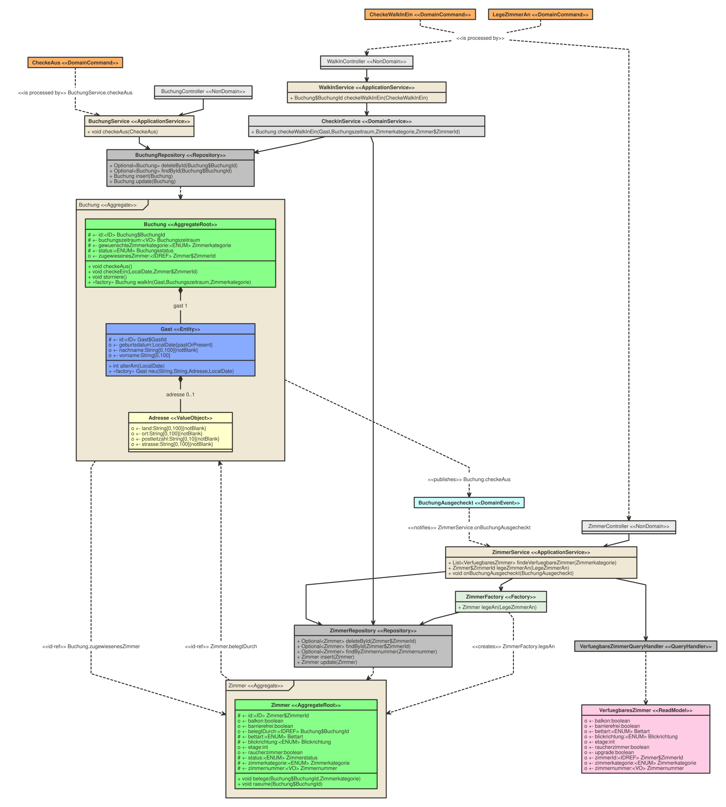
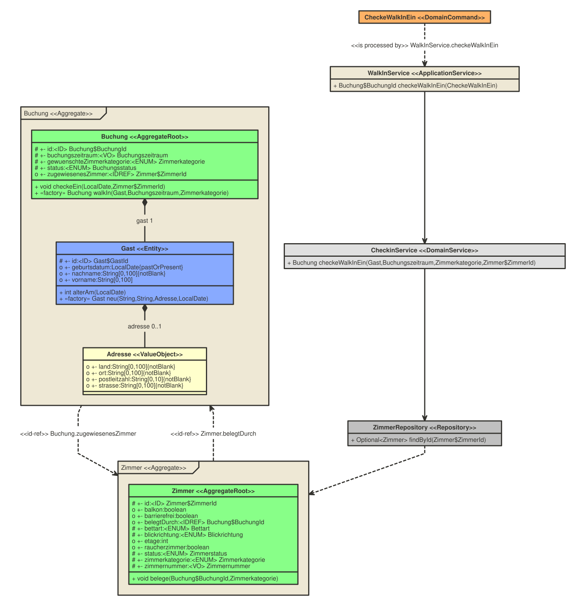
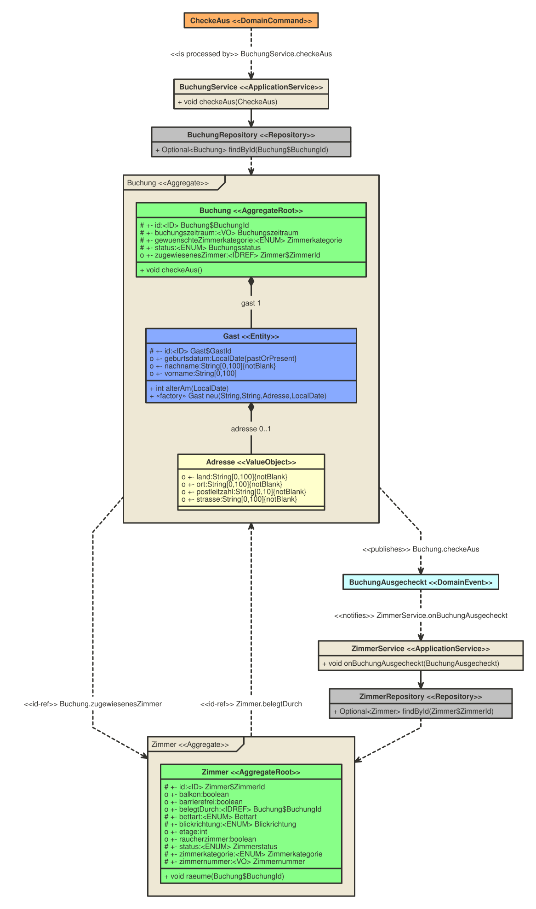
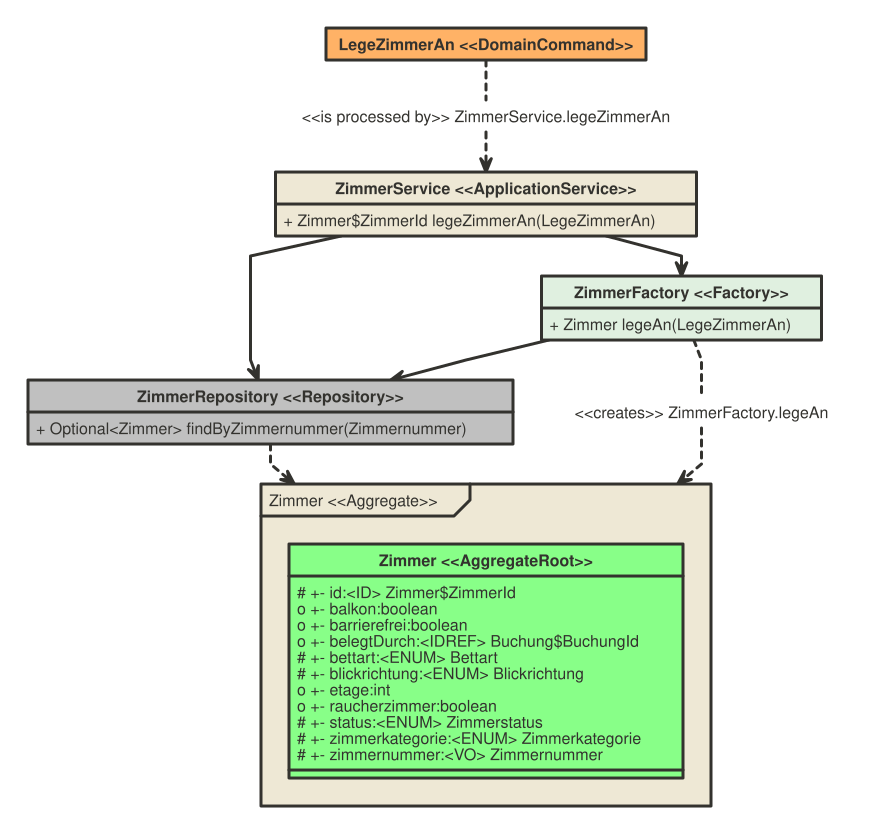
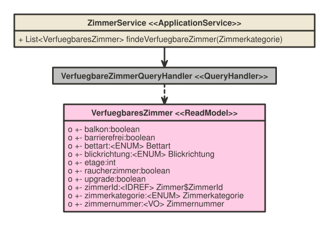

# ddd-hotel-demo – Hotelverwaltung

Demo-Projekt für **taktisches Domain-Driven Design (DDD)** in Java mit der Bibliothek
[DomainLifeCycles (DLC)](https://github.com/esentri/domainlifecycles).

Das Projekt zeigt an einem überschaubaren fachlichen Szenario aus dem Hotelbetrieb:

- wie die taktischen DDD-Bausteine (Aggregate, Entities, Value Objects, Domain Services, Domain Events, …)
  im Code aussehen,
- wie DLC diese Bausteine über **Marker-Interfaces** explizit macht,
- was DLC zur Laufzeit daraus ableitet (Persistenz, JSON-Mapping, Validierung, Domain Events)
- und wie sich das Domänenmodell mit dem DLC-Plugin als **Diagramm** darstellen lässt.

> **Mit KI-Skills erzeugt:** Der Code dieses Projekts wurde mit [Claude Code](https://claude.com/claude-code) und den
> **[DLC-Skills](https://github.com/esentri/DLC-Skills)** erzeugt (siehe [Entstehung mit den DLC-Skills](#entstehung-mit-den-dlc-skills)).

## Inhalt

- [Entstehung mit den DLC-Skills](#entstehung-mit-den-dlc-skills)
- [Technik und Start](#technik-und-start)
- [Szenario: die Rezeption](#szenario-die-rezeption)
- [Geschäftsregeln](#geschäftsregeln)
- [Bounded Context und Paketstruktur](#bounded-context-und-paketstruktur)
- [Taktische Bausteine und DLC-Marker-Interfaces](#taktische-bausteine-und-dlc-marker-interfaces)
- [Aggregate Design](#aggregate-design)
- [Invarianten und Validierung](#invarianten-und-validierung)
- [Transaktionale vs. Eventual Consistency](#transaktionale-vs-eventual-consistency)
- [Factories und Factory Methods](#factories-und-factory-methods)
- [Domain Commands](#domain-commands)
- [Read Models und Query Handler](#read-models-und-query-handler)
- [Persistenz](#persistenz)
- [REST-Schnittstelle](#rest-schnittstelle)
- [Diagramme mit dem DLC-Plugin](#diagramme-mit-dem-dlc-plugin)
- [DLC Diagram Viewer](#dlc-diagram-viewer)
- [Ubiquitous Language](#ubiquitous-language)
- [Weitere Quellen](#weitere-quellen)

## Entstehung mit den DLC-Skills

Domänenmodell, Application Services, Adapter, Migrationen, Tests, Glossar und Diagramme dieses Projekts hat ein
KI-Agent ([Claude Code](https://claude.com/claude-code)) erzeugt. Dabei kamen die
**[DLC-Skills](https://github.com/esentri/DLC-Skills)** (Version 0.10.1) zum Einsatz – Agent Skills für taktisches DDD
in Java, mit und ohne DomainLifeCycles:

| Skill | Wofür |
|---|---|
| `ddd-tactical-java` | Regeln für taktisches DDD: Bounded Contexts, Invarianten, Aggregate, Value Objects, Application Layer, Paketstruktur |
| `ubiquitous-language` | Pflege des Glossars [docs/ubiquitous-language.md](docs/ubiquitous-language.md); neue Begriffe werden beim Implementieren als Kandidaten ergänzt |
| `domainlifecycles` | DLC-Marker-Interfaces und Laufzeitmodule (Persistenz, JSON-Mapping, Validierung, Domain Events) |
| `dlc-persistence-schema` | Tabellen und Flyway-Migrationen für die Aggregate |
| `dlc-diagrammer` | Domänen- und Flow-Diagramme mit dem DLC Gradle Plugin |
| `dlc-diagram-viewer` | Upload des Modells in den DLC Diagram Viewer |

Gearbeitet wurde schrittweise über fachliche Anforderungen in Alltagssprache („Bilde erst den spontanen Check-in ab“,
„Der Gast muss mindestens 16 Jahre alt sein“, „Der Checkout soll per Domain Event entkoppelt werden“ …).
Offene fachliche Fragen – etwa ob der Gast eine eigene Entity in der Buchung ist, welche Zimmermerkmale es gibt oder
ob ein Upgrade erlaubt ist – hat der Agent zurückgefragt, statt sie selbst zu entscheiden. Die Projektentscheidungen,
nach denen die Skills arbeiten (DLC-Modus, Persistenz, Validierungsstil, Sprache der Bezeichner), stehen in
[AGENTS.md](AGENTS.md).

Die Plugins sind für dieses Projekt in [.claude/settings.json](.claude/settings.json) aktiviert. Installation in
Claude Code:

```shell
claude plugin marketplace add esentri/DLC-Skills
claude plugin install ddd-tactical-java@dlc-plugins
claude plugin install domainlifecycles@dlc-plugins
```

Weitere Agenten (Codex, Cursor, …) und Details: siehe README des [DLC-Skills-Repositories](https://github.com/esentri/DLC-Skills).

## Technik und Start

- Java 21, Gradle (Wrapper), Spring Boot 4.1
- DomainLifeCycles 3.5.0 (`dlcVersion` in [gradle.properties](gradle.properties)) mit dem DLC Spring Boot Starter
- Persistenz über die DLC JDBC-Integration, H2 in-memory, Flyway-Migrationen
- Validierung: Bean Validation + `DomainAssertions` über den DLC Validation Extender

```shell
./gradlew build          # bauen und alle Tests ausführen
./gradlew bootRun        # Anwendung starten (http://localhost:8080)
./gradlew createDiagram  # Domänendiagramme nach docs/images erzeugen (benötigt Docker)
```

Nach dem Start: H2-Konsole unter `/h2-console` (JDBC-URL `jdbc:h2:mem:hotelverwaltung`).

## Szenario: die Rezeption

Abgebildet ist der Bounded Context **Rezeption** – die Abläufe vor Ort am Tresen des Hotels.
Zentrales Konzept ist die **Buchung**: Sie steht immer in Verbindung zu einem **Gast**, hat einen
**Buchungszeitraum** und eine **gewünschte Zimmerkategorie**.

Die Use Cases:

| Use Case | Beschreibung |
|---|---|
| **Zimmer anlegen** | Ein Zimmer wird mit Zimmernummer, Zimmerkategorie und Merkmalen (Etage, Blickrichtung, Balkon, barrierefrei, Bettart, Raucherzimmer) erfasst. |
| **Zimmerauswahl** | Die Rezeption sieht eine Übersicht der verfügbaren Zimmer der gewünschten und aller höheren Kategorien (Upgrade) und wählt gemeinsam mit dem Gast ein Zimmer aus – z. B. nach Etage oder Blickrichtung. |
| **Walk-In** | Ein Gast kommt ohne Buchung an den Tresen. Die Buchung entsteht vor Ort und wird sofort eingecheckt; dabei wird das ausgewählte Zimmer zugewiesen. |
| **Check-out** | Der Gast reist ab: die Buchung wird ausgecheckt, das Zimmer ist danach zu reinigen. |

Buchungen können aus verschiedenen Kanälen kommen und bringen nicht immer vollständige Gastdaten mit.
Diese werden spätestens beim Check-in benötigt.

## Geschäftsregeln

Die Geschäftsregeln entscheiden über den Zuschnitt der Aggregate. Im Projekt sind umgesetzt:

**Buchung**
- Eine Buchung hat immer einen Gast, einen Buchungszeitraum und eine gewünschte Zimmerkategorie.
- Die Abreise liegt nach der Anreise.
- Eine Buchung wird höchstens einmal eingecheckt.
- Beim Check-in muss die Adresse des Gastes bekannt sein und der Gast mindestens 16 Jahre alt sein.
- Beim Check-in wird ein Zimmer zugewiesen; eine eingecheckte (oder ausgecheckte) Buchung hat immer ein Zimmer.
- Storniert werden kann nur eine reservierte Buchung – nach dem Check-in nicht mehr.
- Ausgecheckt werden kann nur eine eingecheckte Buchung.

**Gast**
- Pflicht ist nur der Nachname; Vorname, Adresse und Geburtsdatum können (vor dem Check-in) fehlen.
- Das Geburtsdatum liegt nicht in der Zukunft.

**Zimmer**
- Die Zimmernummer ist im Hotel eindeutig.
- Nur ein bezugsfertiges Zimmer kann belegt werden.
- Ein Zimmer passt zu einer Buchung, wenn seine Kategorie gleich oder höher ist als die gewünschte
  (Einzelzimmer < Doppelzimmer < Suite).
- Ein belegtes Zimmer gehört immer zu genau einer Buchung; nur diese Buchung kann es beim Check-out räumen.
- Nach dem Check-out ist das Zimmer zu reinigen.

## Bounded Context und Paketstruktur

Jeder Bounded Context hat ein eigenes Root-Package mit einer `package-info.java`, die mit
`@BoundedContext` annotiert ist ([rezeption/package-info.java](src/main/java/com/esentri/hotel/rezeption/package-info.java)).
Der DLC Domain Mirror leitet daraus die Kontextgrenzen ab.

Innerhalb des Kontexts folgt der Code dem Ports-&-Adapters-Schnitt:

| Package | Inhalt |
|---|---|
| `rezeption.core.domain` | Domänenkern: Aggregate, Entities, Value Objects, Domain Services, Events, Commands, Read Models und die Port-Interfaces (Repositories, Query Handler) |
| `rezeption.core.application` | Application Services – Einstieg in den Domänenkern, Transaktionsgrenze |
| `rezeption.inbound` | Inbound Adapter: REST-Controller |
| `rezeption.outbound` | Outbound Adapter: Implementierungen der Repositories und Query Handler |
| `configuration` | anwendungsweite Spring-Konfiguration |

Abhängigkeiten zeigen immer nach innen: Der Domänenkern kennt weder Web noch Datenbank.

## Taktische Bausteine und DLC-Marker-Interfaces

DLC macht die DDD-Konzepte im Code explizit: Jede Klasse implementiert das Marker-Interface ihres Bausteins
(Package `io.domainlifecycles.domain.types`). Daraus baut DLC beim Start den **Domain Mirror** – ein Metamodell
der Domäne, auf dem Persistenz, JSON-Mapping, Validierung, Event-Verteilung und die Diagramme aufsetzen.

| DDD-Baustein | DLC-Marker | Beispiel im Projekt |
|---|---|---|
| Aggregate Root | `AggregateRoot<ID>` / Basisklasse `AggregateRootBase<ID>` | [Buchung](src/main/java/com/esentri/hotel/rezeption/core/domain/buchung/Buchung.java), [Zimmer](src/main/java/com/esentri/hotel/rezeption/core/domain/zimmer/Zimmer.java) |
| Entity | `Entity<ID>` / Basisklasse `EntityBase<ID>` | [Gast](src/main/java/com/esentri/hotel/rezeption/core/domain/buchung/Gast.java) |
| Identity | `Identity<V>` | `Buchung.BuchungId`, `Gast.GastId`, `Zimmer.ZimmerId` |
| Value Object | `ValueObject` (Records) | [Adresse](src/main/java/com/esentri/hotel/rezeption/core/domain/buchung/Adresse.java), [Buchungszeitraum](src/main/java/com/esentri/hotel/rezeption/core/domain/buchung/Buchungszeitraum.java), [Zimmernummer](src/main/java/com/esentri/hotel/rezeption/core/domain/zimmer/Zimmernummer.java) |
| Enum (Value Object) | – (Enums werden automatisch als Value Objects behandelt) | [Zimmerkategorie](src/main/java/com/esentri/hotel/rezeption/core/domain/zimmer/Zimmerkategorie.java), `Buchungsstatus`, `Zimmerstatus` |
| Domain Service | `DomainService` | [CheckinService](src/main/java/com/esentri/hotel/rezeption/core/domain/buchung/CheckinService.java) |
| Domain Event | `DomainEvent` + `@Publishes` / `@DomainEventListener` | [BuchungAusgecheckt](src/main/java/com/esentri/hotel/rezeption/core/domain/buchung/BuchungAusgecheckt.java) |
| Domain Command | `DomainCommand` | [CheckeWalkInEin](src/main/java/com/esentri/hotel/rezeption/core/domain/buchung/CheckeWalkInEin.java), [CheckeAus](src/main/java/com/esentri/hotel/rezeption/core/domain/buchung/CheckeAus.java), [LegeZimmerAn](src/main/java/com/esentri/hotel/rezeption/core/domain/zimmer/LegeZimmerAn.java) |
| Repository | `Repository<ID, A>` | [BuchungRepository](src/main/java/com/esentri/hotel/rezeption/core/domain/buchung/BuchungRepository.java), [ZimmerRepository](src/main/java/com/esentri/hotel/rezeption/core/domain/zimmer/ZimmerRepository.java) |
| Factory | `Factory` (eigene Klasse), `@FactoryMethod` (erzeugende Methode) | [ZimmerFactory](src/main/java/com/esentri/hotel/rezeption/core/domain/zimmer/ZimmerFactory.java), `Buchung.walkIn`, `Gast.neu` |
| Application Service | `ApplicationService` | [WalkInService](src/main/java/com/esentri/hotel/rezeption/core/application/WalkInService.java), [BuchungService](src/main/java/com/esentri/hotel/rezeption/core/application/BuchungService.java), [ZimmerService](src/main/java/com/esentri/hotel/rezeption/core/application/ZimmerService.java) |
| Read Model / Query Handler | `ReadModel`, `QueryHandler<R>` | [VerfuegbaresZimmer](src/main/java/com/esentri/hotel/rezeption/core/domain/zimmer/VerfuegbaresZimmer.java), [VerfuegbareZimmerQueryHandler](src/main/java/com/esentri/hotel/rezeption/core/domain/zimmer/VerfuegbareZimmerQueryHandler.java) |
| Bounded Context | `@BoundedContext` an `package-info.java` | [rezeption](src/main/java/com/esentri/hotel/rezeption/package-info.java) |

Ein paar Konventionen, die DLC dabei voraussetzt:

- Entities und Aggregate Roots haben genau einen öffentlichen All-Args-Konstruktor mit Lombok `@Builder`;
  DLC erzeugt Objekte darüber (z. B. beim Laden aus der Datenbank oder beim JSON-Mapping).
- Value Objects, Identities, Events, Commands und Read Models sind Java-Records.
- Jede Entity trägt eine `concurrencyVersion` für optimistisches Locking (aus der Basisklasse).
- Services (Repositories, Domain-/Application Services, Query Handler, Factories) werden vom DLC-Starter
  automatisch als Spring Beans registriert – ohne `@Service` oder `@Component`.

## Aggregate Design

Ein Aggregat ist eine **Konsistenzgrenze**: Alles darin wird gemeinsam und transaktional konsistent gehalten,
Zugriffe von außen gehen nur über die Aggregate Root. Aggregate sollen so klein sein, wie es die
Invarianten zulassen.

Im Projekt gibt es zwei Aggregate:

- **Buchung** mit der Entity **Gast** und den Value Objects **Adresse** und **Buchungszeitraum**.
  Der Gast hat keinen eigenen Lebenszyklus außerhalb der Buchung; seine Daten werden mit der Buchung erfasst
  und beim Check-in geprüft.
- **Zimmer** mit seinen Merkmalen und seinem Zimmerstatus.

Die beiden Aggregate referenzieren sich **nur über IDs** (`Buchung.zugewiesenesZimmer`, `Zimmer.belegtDurch`),
nie über Objektreferenzen.



Das vollständige Domänenmodell mit allen Bausteinen:



Die Geschäftslogik liegt in den Aggregaten selbst (`checkeEin`, `checkeAus`, `storniere`, `belege`, `raeume`) –
nicht in Services. Das ist das Gegenteil des klassischen Anti-Patterns
„[Anemic Domain Model](https://martinfowler.com/bliki/AnemicDomainModel.html)“, bei dem Entities nur Getter und Setter
haben und die Regeln in Service-Klassen verstreut sind.

## Invarianten und Validierung

Ein Domänenobjekt darf nie in einem ungültigen Zustand existieren. Im Projekt gilt:

1. **Feld-Invarianten** (Pflichtfeld, Länge, Format) als Bean-Validation-Annotationen, z. B.
   `@NotBlank @Size(max = 100) String nachname`.
2. **Regeln über mehrere Felder** in `validate()` mit `DomainAssertions`, z. B. „Abreise nach Anreise“ in
   `Buchungszeitraum` oder „eine eingecheckte Buchung hat ein Zimmer“ in `Buchung`.
3. **Vorbedingungen von Zustandsübergängen** als `DomainAssertions` am Anfang der fachlichen Methode,
   z. B. das Mindestalter in `Buchung.checkeEin`.

Der **DLC Validation Extender** sorgt dafür, dass Bean Validation und `validate()` automatisch nach jedem
Konstruktor und jeder ändernden Methode laufen – ohne expliziten Aufruf. Lesende Methoden, die nicht der
Getter-Konvention folgen, werden mit `@Query` davon ausgenommen (z. B. `Gast.alterAm`).
Aktiviert wird der Extender in
[HotelverwaltungApplication](src/main/java/com/esentri/hotel/HotelverwaltungApplication.java) und für Tests in
[ValidationExtenderLauncherSessionListener](src/test/java/com/esentri/hotel/ValidationExtenderLauncherSessionListener.java).

Eine verletzte Regel führt zu einer `DomainAssertionException`; die REST-Schnittstelle beantwortet sie mit
HTTP 400 und der fachlichen Meldung.

## Transaktionale vs. Eventual Consistency

Eine zentrale Heuristik für Aggregate lautet: **Eine Transaktion ändert genau ein Aggregat.**
Sie ist eine Daumenregel, kein Dogma. Eine Entscheidungshilfe von Vaughn Vernon und Eric Evans:
*Wessen Aufgabe ist es, die Konsistenz herzustellen?* Liegt sie beim Benutzer, der die Änderung auslöst,
kann eine aggregatübergreifende Transaktion angemessen sein. Sonst ist Eventual Consistency über Domain Events
der bevorzugte Weg.

Das Projekt zeigt beide Varianten.

### Transaktional: Check-in mit Zimmerzuweisung

Beim Walk-In muss das ausgewählte Zimmer **sofort und verlässlich** belegt werden – sonst könnte dasselbe Zimmer
zwei Gästen zugewiesen werden. Buchung und Zimmer ändern sich deshalb in **einer** Transaktion.
Koordiniert wird das vom Domain Service [CheckinService](src/main/java/com/esentri/hotel/rezeption/core/domain/buchung/CheckinService.java):
Die Buchung prüft ihre Regeln (Adresse, Mindestalter), das Zimmer seine (bezugsfertig, passende Kategorie).
Greifen zwei Rezeptionisten gleichzeitig auf dasselbe Zimmer zu, verhindert das optimistische Locking die Doppelbelegung:
Das Speichern der zweiten Änderung scheitert an der Versionsprüfung
(siehe [OptimistischesLockingIntegrationTest](src/test/java/com/esentri/hotel/rezeption/OptimistischesLockingIntegrationTest.java)).



### Eventual: Check-out und Räumen des Zimmers

Beim Check-out ist es fachlich unkritisch, wenn das Zimmer erst einen Moment später auf „zu reinigen“ wechselt.
Der Check-out ändert deshalb nur die Buchung; die Buchung veröffentlicht das Domain Event
[BuchungAusgecheckt](src/main/java/com/esentri/hotel/rezeption/core/domain/buchung/BuchungAusgecheckt.java)
(`DomainEvents.publish`, markiert mit `@Publishes`). Der
[ZimmerService](src/main/java/com/esentri/hotel/rezeption/core/application/ZimmerService.java) reagiert darauf
(`@DomainEventListener`) und räumt das Zimmer in einer eigenen Transaktion.

Mit dem Spring Event Bus des DLC-Starters wird das Event erst **nach dem Commit** zugestellt –
scheitert der Check-out, wird das Zimmer nicht geräumt.



## Factories und Factory Methods

Neue Objekte entstehen nur vollständig gültig. Je nach Komplexität:

- **Factory Method** auf dem Aggregat bzw. der Entity, markiert mit `@FactoryMethod`:
  `Buchung.walkIn(...)`, `Gast.neu(...)`.
- **Dedizierte Factory** (`Factory`), wenn zum Erzeugen weitere Services nötig sind:
  [ZimmerFactory](src/main/java/com/esentri/hotel/rezeption/core/domain/zimmer/ZimmerFactory.java)
  prüft über das Repository, dass die Zimmernummer noch nicht vergeben ist.

In den Diagrammen sind Factory Methods mit `«factory»` markiert, die Factory erzeugt das Zimmer über eine
`<<creates>>`-Beziehung:



## Domain Commands

Domain Commands bilden die **Absicht** eines Benutzers oder Systems ab. Sie sind – anders als Events – noch keine
Tatsache und können abgelehnt werden. Benannt werden sie grammatikalisch im **Imperativ**:
`CheckeWalkInEin`, `CheckeAus`, `LegeZimmerAn`. Commands prüfen nur syntaktisch (Pflichtfelder, Formate);
fachliche Regeln prüft der Domänenkern.

In den Diagrammen sind Domain Commands orange dargestellt, mit einer `<<is processed by>>`-Beziehung zum
verarbeitenden Application Service.

## Read Models und Query Handler

Domänenmodelle sind auf konsistente Änderungen ausgelegt. Für Lese-Anforderungen ist es oft besser,
das Modell nicht „aufzuweichen“, sondern ein eigenes **Read Model** einzuführen („CQRS light“).

Die Zimmerauswahl beim Check-in nutzt das Read Model
[VerfuegbaresZimmer](src/main/java/com/esentri/hotel/rezeption/core/domain/zimmer/VerfuegbaresZimmer.java):
eine flache Sicht mit allen Merkmalen, die für die Auswahl mit dem Gast wichtig sind, inklusive Upgrade-Kennzeichen.
Geliefert wird es von einem `QueryHandler` – nicht von einem Repository. Die Implementierung
([JdbcVerfuegbareZimmerQueryHandler](src/main/java/com/esentri/hotel/rezeption/outbound/JdbcVerfuegbareZimmerQueryHandler.java))
liest direkt per SQL, ohne Aggregate zu laden.



## Persistenz

Repositories laden und speichern immer **ganze Aggregate**. Die Implementierungen erben von
`JdbcAggregateRepository` der DLC JDBC-Integration und sind dadurch sehr schlank
(z. B. [JdbcBuchungRepository](src/main/java/com/esentri/hotel/rezeption/outbound/JdbcBuchungRepository.java)).
DLC bildet das Aggregat per Konvention auf Tabellen ab:

- eine Tabelle pro Entity bzw. Aggregate Root (`buchung`, `gast`, `zimmer`),
- Value Objects als eingebettete Spalten (`buchungszeitraum_anreise`, `adresse_ort`, `zimmernummer_value`),
- Fremdschlüssel innerhalb eines Aggregats (`gast.buchung_id`), keine Fremdschlüssel zwischen Aggregaten,
- `concurrency_version` für optimistisches Locking.

Das Schema wird mit Flyway angelegt: [db/migration](src/main/resources/db/migration).

## REST-Schnittstelle

Beispiel für einen kompletten Ablauf (Anwendung mit `./gradlew bootRun` starten):

```shell
# Zimmer anlegen
curl -X POST localhost:8080/api/rezeption/zimmer -H 'Content-Type: application/json' -d '{
  "zimmernummer": "101", "zimmerkategorie": "DOPPELZIMMER", "etage": 1, "blickrichtung": "PARK",
  "balkon": true, "barrierefrei": false, "bettart": "DOPPELBETT", "raucherzimmer": false }'

# verfügbare Zimmer für die Zimmerauswahl (gewünschte und höhere Kategorien)
curl 'localhost:8080/api/rezeption/zimmer/verfuegbar?gewuenschteZimmerkategorie=EINZELZIMMER'

# Walk-In mit dem ausgewählten Zimmer
curl -X POST localhost:8080/api/rezeption/walk-ins -H 'Content-Type: application/json' -d '{
  "vorname": "Erika", "nachname": "Mustermann", "geburtsdatum": "1985-04-12",
  "adresse": { "strasse": "Hauptstraße 1", "postleitzahl": "76131", "ort": "Karlsruhe", "land": "Deutschland" },
  "abreise": "2026-12-24", "gewuenschteZimmerkategorie": "EINZELZIMMER", "zimmerId": "<zimmerId>" }'

# Check-out
curl -X POST localhost:8080/api/rezeption/buchungen/<buchungId>/checkout
```

Die Abreise muss nach dem heutigen Tag liegen.

## Diagramme mit dem DLC-Plugin

Alle Diagramme in diesem README erzeugt das
[DLC Gradle Plugin](https://github.com/esentri/domainlifecycles) direkt aus dem Code:

```shell
./gradlew createDiagram
```

Die Konfiguration steht im Block `dlcGradlePlugin.diagram` in [build.gradle](build.gradle). Für SVG startet das
Plugin einen Kroki-Container, Docker muss also laufen. Zwei Arten von Diagrammen werden erzeugt:

- **Strukturdiagramme** – das ganze Modell (`domaenenmodell`) oder nur die Aggregatgrenzen (`aggregate`,
  Option `showOnlyAggregateFrames`).
- **Flow-Diagramme** – alles, was von einem Einstiegspunkt aus erreichbar ist (`includeFlowsFrom`).
  Das Plugin ermittelt das per statischer Bytecode-Analyse und folgt dabei Aufrufen, verarbeiteten Commands und
  veröffentlichten Domain Events. Deshalb zeigt der Check-out-Flow auch den `ZimmerService` als Listener.

Die Diagramme sind nur so gut wie die Marker im Code: Eine Klasse ohne Marker-Interface fehlt im Diagramm
oder erscheint als `<<NonDomain>>`; ohne `@Publishes` bzw. `@DomainEventListener` fehlen die Event-Pfeile.

## DLC Diagram Viewer

Statt statischer Bilder lässt sich das Domänenmodell auch interaktiv im
[DLC Diagram Viewer](https://github.com/esentri/diagram-viewer) erkunden – mit Filtern, Flow-Ansichten auf Basis der
statischen Analyse und Auswertungen über Bounded Contexts, Commands und Read Models.

1. Den Viewer lokal mit Docker Compose starten (siehe README des Diagram-Viewer-Repositories);
   er läuft dann unter <http://localhost:8090>.
2. Im Viewer ein Konto anlegen, einloggen und über das Benutzermenü den API-Key kopieren.
3. Den API-Key als Umgebungsvariable setzen und das Modell hochladen:

   ```shell
   export DLC_VIEWER_API_KEY=<api-key>
   ./gradlew domainModelUpload
   ```

Die Upload-Konfiguration steht im Block `dlcGradlePlugin.domainModelUpload` in [build.gradle](build.gradle).
Der API-Key gehört nie in die Build-Datei oder ins Repository.

## Ubiquitous Language

Die Fachbegriffe des Projekts – mit Definition, Name im Code und Status – stehen im Glossar
[docs/ubiquitous-language.md](docs/ubiquitous-language.md). Fachbegriffe sind im Code deutsch
(ohne Umlaute: `ae`, `oe`, `ue`, `ss`), technische Begriffe englisch (`Repository`, `Service`, `Id`, …).

## Weitere Quellen

- Eric Evans: *Domain-Driven Design: Tackling Complexity in the Heart of Software*, 2003
- Vaughn Vernon: *Implementing Domain-Driven Design*, 2013
- [DDD Reference (Eric Evans)](https://www.domainlanguage.com/wp-content/uploads/2016/05/DDD_Reference_2015-03.pdf)
- [Aggregate Design Rules nach Vernon](https://www.archi-lab.io/infopages/ddd/aggregate-design-rules-vernon.html)
- [Aggregate Design Canvas (DDD Crew)](https://github.com/ddd-crew/aggregate-design-canvas)
- [CQRS: Commands als Teil des Domänenmodells](https://enterprisecraftsmanship.com/posts/cqrs-commands-part-domain-model/)
- [Read Models als taktisches Pattern](http://gorodinski.com/blog/2012/04/25/read-models-as-a-tactical-pattern-in-domain-driven-design-ddd/)
- [DomainLifeCycles auf GitHub](https://github.com/esentri/domainlifecycles)
- [DLC-Skills auf GitHub](https://github.com/esentri/DLC-Skills)
